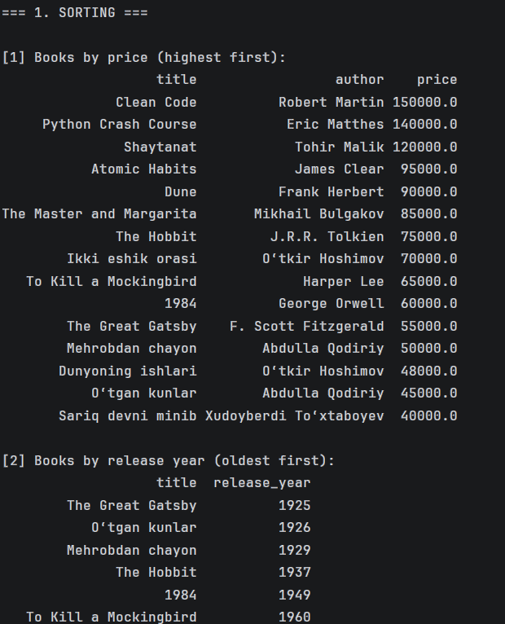

# SQL Practice: Books Library (SQLite, pandas)

A set of 21 SQL queries on a small books database. The script creates the database, fills it with 15 books and prints the result of every query as a table.

## What this project covers

- Sorting: `ORDER BY` (single and multiple columns)
- Filtering: `WHERE`, `BETWEEN`, `IN`, `AND` / `OR`
- Pattern search: `LIKE`
- Aggregation: `COUNT`, `AVG`, `MIN`, `MAX`, `ROUND`
- Grouping: `GROUP BY`
- Advanced queries: `LIMIT`, subquery (longest book per language)

## Example output



## How to run

```bash
pip install -r requirements.txt
python books_queries.py
```

The database file `books_library.sqlite` is created automatically on the first run.

## Tools

Python, SQLite, pandas
